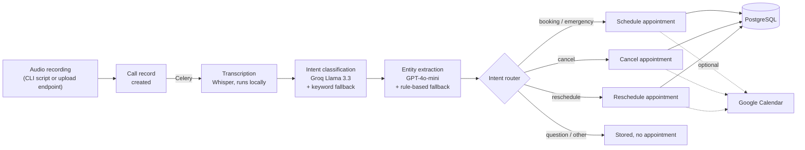
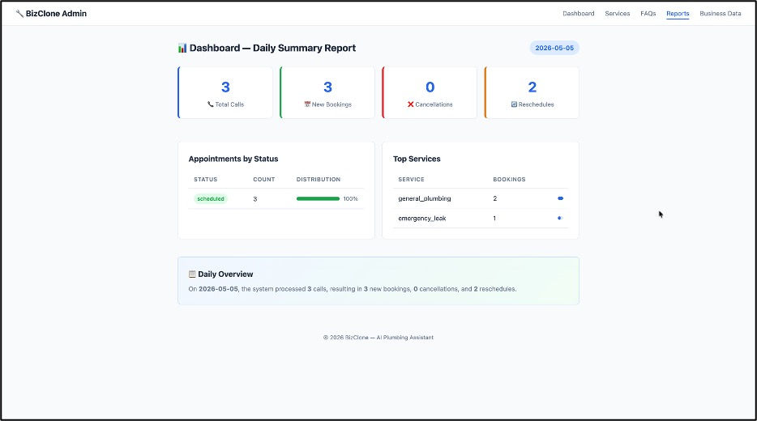
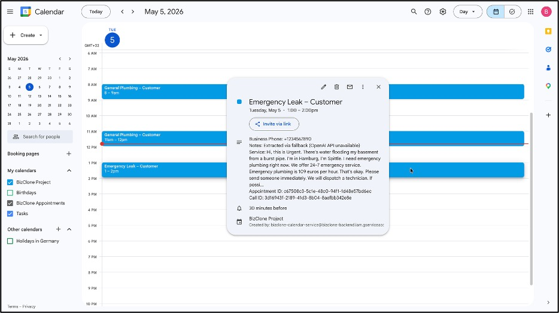

# BizClone — Voice Booking Assistant for a Plumbing Business

A backend that turns a customer's recorded phone message into a booked, cancelled or rescheduled appointment. It transcribes the audio locally with Whisper, classifies the caller's intent with an LLM, extracts the booking details, and updates PostgreSQL and (optionally) Google Calendar — all as a chain of Celery background tasks behind a FastAPI service.

Built as my individual module within an MSc Applied Data Science and Analytics case-study project (SRH University of Applied Sciences Heidelberg, Hamburg campus, February–May 2026). The scenario business, "BizClone Plumbing Services" in Hamburg, is fictional.

## At a glance

| | |
|---|---|
| **Input** | Recorded customer calls (audio files) via a CLI script or an upload endpoint |
| **Pipeline** | Whisper transcription → intent classification → entity extraction → intent routing → booking / cancellation / rescheduling |
| **Stack** | Python 3.11, FastAPI, SQLAlchemy, Alembic, PostgreSQL, Celery, Redis, OpenAI Whisper (local), Groq (Llama 3.3), OpenAI GPT-4o-mini, Google Calendar API, Jinja2, pytest, Docker Compose |
| **Tests** | 173 automated tests (pytest); one integration test needs a running PostgreSQL and is skipped otherwise |
| **Status** | Working local prototype; not deployed |

## How it works



1. **Transcription.** The recording is transcribed with OpenAI's open-source Whisper model running on the local machine; no audio is sent to an external API.
2. **Intent classification.** Groq (Llama 3.3 70B) assigns one of eight intents: booking, reschedule, cancel, pricing, availability, service question, emergency, other. If the API is unavailable, a keyword classifier takes over.
3. **Entity extraction.** GPT-4o-mini extracts structured details — contact name and phone, address, service type and description, requested date and time, and urgency — with a rule-based fallback.
4. **Routing.** An intent router decides the action. Cancel and reschedule requests never fall back to creating a new booking; booking requests without an explicit date or time are still booked but flagged; emergencies are scheduled immediately; questions about pricing, availability or services are stored without an appointment.
5. **Scheduling.** Requested times are validated (not in the past, Monday–Friday, within business hours), conflicts are checked, and the next free slot is proposed if needed. Appointments are stored in PostgreSQL and, if configured, created, updated or deleted in Google Calendar.

Each step writes its result to the database, so every call can be traced from recording to appointment.

## Screenshots

| Admin dashboard: daily report | Google Calendar after processing three calls |
|---|---|
|  |  |

## Features

- Asynchronous processing pipeline with chained Celery tasks
- Fallbacks for every external AI service, so the pipeline keeps working without API access
- Booking, cancellation and rescheduling flows with time validation and conflict handling
- Optional two-way consistency with Google Calendar (service-account authentication)
- Business knowledge (services, policies, 50 FAQs) loaded from `business_data.json` into PostgreSQL at startup
- Admin dashboard (server-rendered with Jinja2) to manage services and FAQs and view daily reports
- REST API for calendar views, availability, appointments and call records; interactive docs at `/docs`
- Alembic database migrations

## Tech stack

| Area | Tools |
|---|---|
| API and web | FastAPI, Jinja2 templates, Uvicorn |
| Data | PostgreSQL, SQLAlchemy, Alembic |
| Background processing | Celery, Redis |
| Speech and language | Whisper (local), Groq API (Llama 3.3 70B), OpenAI API (GPT-4o-mini) |
| Integrations | Google Calendar API |
| Testing and tooling | pytest, pytest-mock, Docker Compose |

## Repository structure

```
backend/
  app/
    api/            REST endpoints, upload endpoint, admin dashboard routes, reports
    config/         Settings loaded from environment variables
    core/           Logging, middleware, business data loader (business_data.json)
    db/             Database session and CRUD functions
    models/         SQLAlchemy models (calls, transcripts, appointments, customers, ...)
    schemas/        Pydantic request/response models
    services/
      ai/           Intent classifier, entity extractor, conversation state, priority detector
      voice/        Whisper transcription and audio handling
      scheduling/   Scheduler, time validation, intent router, cancel and reschedule
      integrations/ Google Calendar
      calendar/     Calendar views and availability
      reporting/    Daily summary
    templates/      Admin dashboard pages
    workers/        Celery app and pipeline tasks
  migrations/       Alembic migrations
  tests/            pytest suite
  process_recording.py   CLI entry point for processing a recording
docker-compose.yml  PostgreSQL and Redis for local development
requirements.txt    Runtime dependencies
requirements-dev.txt  Test and development dependencies
```

## Getting started

### Prerequisites

- Python 3.11
- Docker Desktop (for PostgreSQL and Redis)
- ffmpeg, required by Whisper (macOS: `brew install ffmpeg`)
- A Groq API key and an OpenAI API key (optional: without them the keyword and rule-based fallbacks are used)

### Installation

```bash
git clone https://github.com/samu2421/BizClone.git
cd BizClone
python3.11 -m venv venv
source venv/bin/activate
pip install -r requirements-dev.txt
cp .env.example .env        # then add your API keys to .env
```

The `.env` file must stay in the repository root; the application reads it from there.

### Run locally

```bash
# 1. Start PostgreSQL and Redis
docker compose up -d

# 2. Create the database tables
cd backend
alembic upgrade heads

# 3. Start the Celery worker (terminal 1, inside backend/)
celery -A app.workers.celery_app worker --loglevel=info --pool=solo

# 4. Start the API (terminal 2, inside backend/)
uvicorn app.main:app --reload
```

Use `heads` (plural): the migration history currently has two branches. On macOS, `--pool=solo` avoids Celery worker issues.

If PostgreSQL is also installed through Homebrew, stop it first (`brew services stop postgresql@14`); both use port 5432.

### Process a recording

Place a short `.wav` recording in `backend/data/recordings/` and run (terminal 3, inside `backend/`):

```bash
python process_recording.py --file data/recordings/call_01.wav
```

Optional arguments: `--customer-phone` and `--business-phone`. Follow progress in the Celery worker's output.

### Explore the results

| URL | What it shows |
|---|---|
| http://localhost:8000/docs | Interactive API documentation |
| http://localhost:8000/admin/ | Admin dashboard: services, FAQs, reports |
| http://localhost:8000/reports/daily | Daily summary of calls and appointments (JSON) |
| http://localhost:8000/health | Service health check |

### Reset demo data

```bash
docker exec -it bizclone_postgres psql -U bizclone_user -d bizclone_db \
  -c "TRUNCATE calls, transcripts, appointments, conversation_states RESTART IDENTITY CASCADE;"
docker exec -it bizclone_redis redis-cli flushall
```

## Configuration

All settings are read from environment variables; `.env.example` lists every variable the code uses. The most important ones:

| Variable | Purpose |
|---|---|
| `DATABASE_URL`, `REDIS_URL` | Match `docker-compose.yml` by default |
| `GROQ_API_KEY`, `OPENAI_API_KEY` | AI services (fallbacks are used if empty) |
| `WHISPER_MODEL` | Whisper model size (`base` by default) |
| `BUSINESS_HOURS_START`, `BUSINESS_HOURS_END`, `BUSINESS_TIMEZONE` | Scheduling rules (08:00–18:00, Europe/Berlin) |
| `GOOGLE_CREDENTIALS_FILE`, `GOOGLE_TARGET_CALENDAR` | Optional Google Calendar sync via a service account |

## Testing

```bash
cd backend
pytest -q --no-cov
```

The suite contains 173 tests covering the scheduler, time validation, cancellation and rescheduling, intent classification, entity extraction, priority detection, transcription, conversation state, calendar views and the database layer. External services (Whisper, Groq, OpenAI, Google Calendar) are mocked, and database tests use an in-memory SQLite database. One integration test checks the health endpoint against a real PostgreSQL and is skipped when none is running.

Running `pytest` without `--no-cov` also produces a coverage report.

## Limitations

- **No live phone integration.** The system processes recorded audio files; it does not answer calls in real time. An earlier Twilio webhook prototype was removed.
- **No spoken replies.** A response generator (`services/ai/response_generator.py`) is implemented and tested but not yet connected to the pipeline, so callers receive no automated reply.
- **Priority detection is not wired in.** The keyword-based urgency detector is implemented and tested, but the pipeline currently handles emergencies through the "emergency" intent only.
- **Business knowledge is not retrieval-based.** Services, policies and FAQs are stored in PostgreSQL from a JSON file; there is no vector search or RAG.
- **The admin dashboard has no authentication** and is intended for local use only.
- **English only** (Whisper language set to `en`); not containerised beyond PostgreSQL and Redis; not deployed.

## Possible next steps

- Connect the response generator and priority detector to the pipeline
- Real-time call handling through a telephony provider
- Authentication for the admin dashboard
- Containerise the API and Celery worker
- Retrieval over the FAQ and policy data for answering customer questions

## Author and project context

Samiksha Dhere. The case-study project was assigned to a group, with each member building a separate customer channel of the same assistant. This repository contains the voice-call module, which I designed and implemented individually.